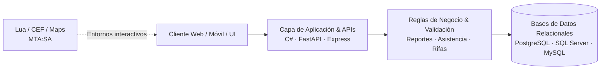

<div align="center">

# `~/1reyDEV` — Software Engineering & Backend Profile

`C# (.NET)` · `Python (FastAPI)` · `Node.js (Express)` · `PostgreSQL` · `SQL Server` · `Lua`

[](https://github.com/1reyDEV)
[](mailto:tu_correo@ejemplo.com)


</div>

---

### `$ cat /etc/1reydev/identity.yml`

```yaml
developer:
  handle: "1reyDEV"
  name: "Reymi Ismael Mieses Ventura"
  program: "Ingeniería de Software (UTECO)"
  location: "Cotuí, República Dominicana"
  environments: ["Linux Mint", "Windows"]

core_stack:
  backend_and_apis: ["C#", ".NET", "Python", "FastAPI", "Node.js", "Express"]
  databases: ["PostgreSQL", "SQL Server", "MySQL"]
  web_and_scripting: ["HTML5", "CSS3", "JavaScript", "Lua (MTA:SA)"]

focus_areas:
  - "APIs, lógica de negocio y consultas relacionales eficientes"
  - "Modelado UML, arquitectura de sistemas y seguridad informática"
  - "Herramientas prácticas que resuelven problemas reales"
```

---

### `$ ./architecture-overview.sh`



---

### `$ ls -la ./projects`

| Proyecto | Qué hace | Stack principal |
| :--- | :--- | :--- |
| **`generar_reporte_analitico`** | Consolida y agrega registros de ventas para devolver reportes JSON estructurados. | `Python` `FastAPI` `PostgreSQL` |
| **Plataforma de Rifas Digitales** | Selección interactiva de boletos, barra de progreso, carga de comprobantes y validación. | `Node.js` `Express` `PostgreSQL` `JS` |
| **App Web de Control de Asistencia** | Importación masiva de listas, filtros en vivo, porcentajes e historial de faltas/tardanzas. | `HTML5` `CSS3` `JavaScript` |
| **`TiendaPrueba` (DB Schema)** | Tablas `Clientes`, `Productos` y `Ventas` con relaciones y vistas basadas en `JOIN`. | `SQL Server` `SQL` |

---

### `$ git status`

- `[ACTIVE]` Mejorando el sistema de **pase de lista estudiantil** (importación masiva, métricas e historial diario).
- `[ACTIVE]` Profundizando en **seguridad informática / pentesting**, análisis de riesgos y planes de contingencia.
- `[ACTIVE]` Practicando **POO en C#**, diseño de bases de datos y flujo de trabajo con Git.

---

<div align="center">

`exit 0` · **1reyDEV** — *Código claro, pruebas reales y mejora continua.*

</div>
